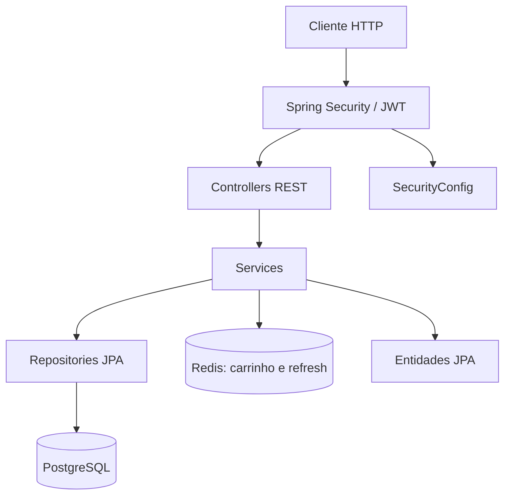

# Arquitetura do Sistema

**Sistema:** ecommerce-springboot 1.0.0 | **Base:** ZIP fornecido | **Data da análise:** 17/11/2026

## 1. Visão arquitetural
Aplicação Spring Boot única (um `pom.xml`, uma classe `EcommerceApplication`) estruturada em pacotes lógicos `controller`, `service`, `repository`, `model`, `config`. Não existem módulos Maven independentes nem microsserviços no código examinado.

## 2. Padrões utilizados
- Controller–Service–Repository, injeção de dependência por construtor, Spring Data JPA e entidades JPA.
- APIs REST versionadas em `/api/v1`; validação Jakarta Bean Validation em alguns endpoints; tratamento centralizado de exceções com `@RestControllerAdvice`.
- Segurança stateless com Spring Security Resource Server, JWT HS256 e BCrypt; autorização administrativa com `@PreAuthorize` no catálogo.
- Redis via `StringRedisTemplate` para carrinhos JSON com TTL de 30 dias e refresh token com TTL de 7 dias.
- Transações JPA em `OrderService.checkout`, `PaymentService.confirm` e `PaymentService.cancel`.

## 3. Regras arquiteturais observadas versus propostas
**Observadas:** Controllers delegam aos services; repositories estendem `JpaRepository`; entidades ficam em `model`; APIs de catálogo GET são públicas; alterações de catálogo exigem ADMIN; demais rotas exigem autenticação; usuários podem operar seus próprios registros, ADMIN pode operar outros.

**Propostas para SDD (não implementadas como validação automática):** proibir regras de negócio em controllers; expor DTOs em vez de entidades; manter transações e invariantes no service; limitar dependências entre domínios; exigir testes de contrato/integração; versionar schema com migrações; revisar autorização em cada caso de uso.

## 4. Convenções técnicas
- Java 21 em `pom.xml` e Dockerfile; Spring Boot 3.5.6; Maven; PostgreSQL 16 e Redis 7 no Compose.
- IDs `String` inicializados com UUID; datas `Instant`; valores monetários `BigDecimal`; enums `Role`, `ProductStatus`, `OrderStatus`.
- `application.yml`: variáveis `PORT`, `DATABASE_URL`, `DB_USER`, `DB_PASSWORD`, `REDIS_HOST`, `REDIS_PORT`, `JWT_SECRET`.
- `spring.jpa.open-in-view=false`, `ddl-auto=update` (comentado como somente desenvolvimento).

## 5. Separação de responsabilidades
| Pacote | Papel | Dependências principais |
|---|---|---|
| `config` | Filtros/autenticação, beans JWT/BCrypt e tratamento de erros | Spring Security, Spring Web, ApiException |
| `controller` | Entrada HTTP e autorização declarativa do catálogo | Services, Spring MVC/JWT |
| `service` | Orquestração e regras de negócio | Repositories, entidades, Redis, JWT/BCrypt |
| `repository` | Persistência relacional | Model, Spring Data JPA |
| `model` | Entidades e enums | JPA, Jackson |
| `resources` | Configuração | Spring Boot, PostgreSQL, Redis |

## 6. Fluxos de comunicação e negócio
1. **Registro/login:** `AuthController` → `AuthService` → `UserRepository`/BCrypt → `JwtEncoder`; grava refresh em Redis. Login valida hash; registro cria USER. Não há endpoint de refresh no código.
2. **Catálogo:** `CatalogController` → `CatalogService` → `CategoryRepository`/`ProductRepository`; alterações exigem ADMIN. Listagem de produtos filtra e pagina em memória após `findAll()`.
3. **Carrinho:** `CartController` → `CartService` → `ProductRepository` + Redis (`cart:default:<userId>`); `remove` recebe `itemId`, mas compara com `productId`.
4. **Checkout:** `OrderController` → `OrderService.checkout` → Redis/CartService, UserRepository, ProductRepository, PurchaseOrderRepository; verifica estoque, reduz quantidade, salva pedido/itens, limpa carrinho.
5. **Pagamento:** `PaymentController` → `PaymentService` → `OrderService.find`, `PaymentRepository`, `PurchaseOrderRepository`; cria pagamento interno, confirma como PAID ou cancela como CANCELED. Não há chamada a adquirente/gateway externo.
6. **Usuários:** `UserController` → `UserService` → `UserRepository`; checagem de titularidade ou ADMIN.

## 7. Dependências críticas
- PostgreSQL: usuários, produtos, categorias, pedidos e pagamentos.
- Redis: leitura/gravação do carrinho e armazenamento de refresh tokens; indisponibilidade pode afetar registro/login e checkout.
- Segredo `app.jwt-secret`: compartilhado entre `JwtEncoder` e `JwtDecoder`; o valor default é apenas de desenvolvimento.
- `OrderService` depende de `CartService`; `PaymentService` depende de `OrderService` para buscar pedidos e do repositório de pedidos para persistir mudanças.
- `docker-compose.yml` inicia somente PostgreSQL e Redis; API roda separadamente com Maven ou imagem construída pelo Dockerfile.

## 8. Riscos, acoplamentos e violações / lacunas
| Prioridade | Evidência | Risco ou débito |
|---|---|---|
| Crítica | `SecurityConfig.jwtDecoder` e conversor de authorities não verificam claim `type` | Refresh token pode ser aceito como bearer nas rotas protegidas se válido e assinado |
| Alta | `OrderService.checkout`: reduz estoque e chama `carts.clear` dentro de transação JPA | Redis e PostgreSQL não têm atomicidade conjunta; falha posterior pode deixar carrinho limpo |
| Alta | Leitura/salvamento de `Product.stock` sem locking/versionamento explícito | Checkout concorrente pode gerar inconsistência de estoque |
| Alta | `PaymentService.confirm` apenas exige chave não vazia | `Idempotency-Key` não é persistida/associada à requisição; sem idempotência por chave demonstrada |
| Alta | `PaymentService.cancel` altera `item.product.stock`, mas não chama `ProductRepository.save` | Persistência da reposição depende do estado gerenciado JPA; exige teste transacional |
| Alta | `CatalogService.products` usa `findAll().stream()` | Paginação e busca em memória; risco de desempenho |
| Alta | `EcommerceApplicationTests.projectSkeleton()` só contém `assertTrue(true)` | Ausência de cobertura útil de regras e integrações |
| Média | Controllers retornam entidades JPA diretamente | Acoplamento de contrato, dados excessivos e riscos de serialização de relacionamentos LAZY |
| Média | `User`, `Product`, `PurchaseOrder` têm `tenantId=default`, sem filtro por tenant | Isolamento multi-tenant não implementado no código inspecionado |
| Média | `application.yml` usa `ddl-auto=update` e valores padrão de credenciais | Schema sem migrações e risco de configuração insegura fora de desenvolvimento |
| Média | `SecurityConfig` libera `/actuator/health`, mas `pom.xml` não inclui Actuator | Regra para endpoint sem implementação identificada |
| Média | `ProductRepository.findByNameContainingIgnoreCase` não é chamado pelo serviço | Método aparentemente não utilizado; candidato a revisar, não classe órfã |
| Média | `Payment.externalId` e `updatedAt` não são atualizados em serviços de pagamento | Campos sem uso funcional comprovado ou atualização de auditoria |
| Média | `CartController.remove` usa rota `itemId` e `CartService.remove` compara `productId` | Contrato de identificação ambíguo |

**Módulos órfãos:** nenhum dos cinco pacotes principais está isolado do fluxo da aplicação. Há elementos sem uso identificado (consulta paginada do repositório, `externalId` e endpoint Actuator configurado). Não foram detectados módulos Maven adicionais.

## 9. Diretrizes para futuras implementações / SDD
1. Especificar comportamento atual com referências de classe/método e marcar toda extrapolação como **Hipótese**.
2. Definir contratos HTTP, DTOs, autenticação/autorização, invariantes, estados e cenários de erro.
3. Escrever testes de aceite para registro/login, acesso ADMIN, carrinho, checkout concorrente e pagamentos.
4. Corrigir verificação do tipo JWT, idempotência e consistência do estoque antes de considerar produção.
5. Separar configurações de desenvolvimento e produção; substituir `ddl-auto=update` por migrações versionadas.
6. Manter README local sincronizado com mudanças em controllers, services, repositories e entidades.
7. Automatizar verificação de arquitetura e geração de inventário em CI; a documentação atual é um snapshot estático, não sincronização contínua.

## 10. Limites da evidência
Análise estática do ZIP: arquivos, imports, anotações, métodos e configurações. Não foram executados Maven, PostgreSQL, Redis nem testes de integração. Comportamentos de runtime não comprovados são riscos a validar, não falhas reproduzidas.

**Hipótese:** o campo `tenantId` indica intenção futura de multi-tenancy; não há implementação de isolamento que confirme essa intenção.
